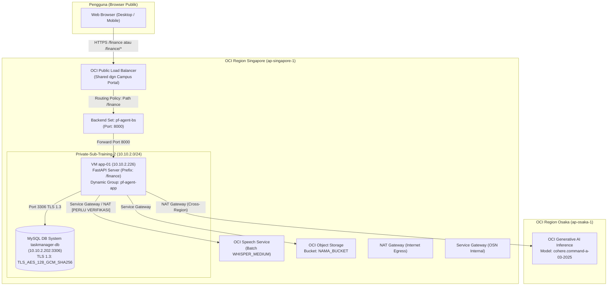
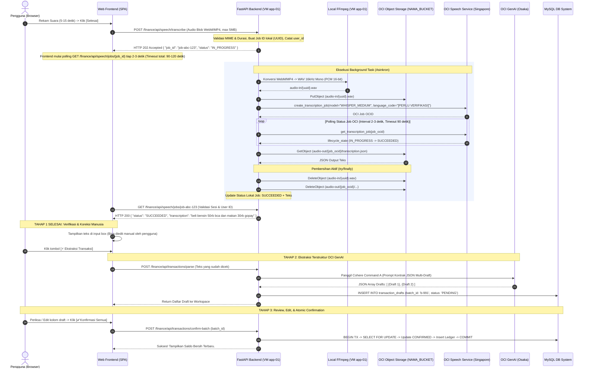
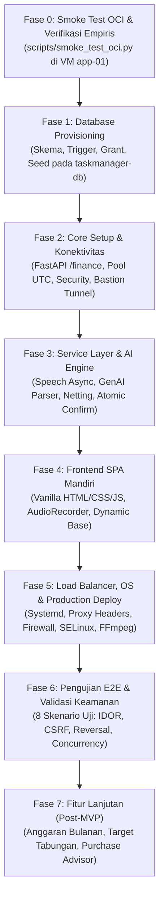

# Blueprint & Master Execution Plan: Personal Finance AI Agent (v2.3 OCI Native)

---

## Riwayat Revisi Dokumen

| Versi | Tanggal | Ringkasan Perubahan Utama |
| :--- | :--- | :--- |
| **v2.0 - v2.2** | [Diisi pemilik dokumen] | Dokumen awal arsitektur Personal Finance AI Agent OCI Native. |
| **v2.3** | [Diisi pemilik dokumen] | **Revisi Teknis Komprehensif (29 Poin Perbaikan & Audit Mandiri):**<br>• Hak akses `fin_bot_app` diperluas untuk edit draft, user lockout, insert akun/kategori, dan `REQUIRE SSL` pada host `10.10.2.%`.<br>• Alur Speech diubah menjadi asinkron (`POST transcribe` -> `GET jobs/{id}`) dengan konversi `ffmpeg` WebM->WAV 16kHz mono dan pembersihan ganda.<br>• Penambahan **Fase 0: Smoke Test OCI** fungsional sebelum migrasi DB.<br>• IAM policy formal untuk `pf-agent-app` dan penandaan `[PERLU VERIFIKASI]` untuk policy Service Principal `aispeech`.<br>• Bukti matematis netting reversal untuk INCOME, EXPENSE, dan TRANSFER majemuk + admin fee.<br>• Constraint `chk_tx_admin_fee`, trigger terpisah di `02_triggers.sql`, penghapusan kolom yang tidak terpakai pada `app_users`, dan penetapan fitur lanjutan Fase 7.<br>• Pengamanan proxy headers Uvicorn, proteksi CSRF, session server-side, rate limiting in-memory, dan isolasi multi-tenant anti-IDOR. |

---

## 1. Ringkasan Eksekutif & Tujuan Sistem

Personal Finance AI Agent adalah sistem pencatatan dan analisis keuangan pribadi mandiri berbasis Web (*Single Page Application*). Aplikasi ini dirancang khusus untuk berjalan di ekosistem **Oracle Cloud Infrastructure (OCI)** dengan mengintegrasikan layanan AI native OCI, database terkelola **MySQL HeatWave DB System**, dan komputasi awan berkeamanan tinggi.

### 1.1. Fitur Utama:
1. **Input Teks Kalimat Bebas (Bahasa Indonesia):** Pengguna dapat mengetik mutasi keuangan dalam ragam bahasa santai maupun formal.
2. **Input Suara Dua Tahap Asinkron (Transparan):** Pengguna merekam suara via browser $\rightarrow$ backend mengonversi audio dan men-submit batch job ke OCI Speech $\rightarrow$ frontend melakukan polling status $\rightarrow$ **hasil teks ditampilkan di layar untuk diverifikasi/diedit pengguna** $\rightarrow$ pengguna menekan tombol proses untuk dikirim ke OCI Generative AI.
3. **Ekstraksi Multi-Transaksi dalam Satu Kalimat:** Satu kalimat atau rekaman yang memuat banyak mutasi sekaligus (misal: belanja, makan, dan transfer) dipecah menjadi beberapa baris draft terpisah yang diikat oleh `batch_id`.
4. **Draft Review & Batch Confirmation Workspace:** Draft transaksi dapat diperiksa, diedit (nominal, akun, kategori), dibatalkan per baris, atau dikonfirmasi serentak (*Confirm All*) sebelum masuk ke buku besar.
5. **Buku Besar Abadi (*Immutable Ledger*):** Tabel transaksi bersifat *append-only*. Mutasi yang salah dibatalkan melalui mekanisme **Jurnal Pembalik (*Reversal Transaction*)** dengan formula netting matematis.
6. **Pemisahan Logika Transfer vs Pengeluaran:** Transfer antarakun tidak dihitung sebagai beban pengeluaran belanja. Biaya admin dicatat sebagai baris beban terpisah yang terhubung via `parent_transaction_id`.
7. **Kebijakan Saldo Negatif [DEFAULT]:** Sistem mengizinkan saldo akun bernilai negatif (untuk mengakomodasi keterlambatan pencatatan uang masuk, cerukan, atau kas defisit), namun antarmuka web menampilkan peringatan visual (*warning alert*) yang jelas.
8. **Keamanan Web Enterprise:** Otentikasi berbasis Username/Password (Argon2id), pencabutan sesi di sisi server (`web_sessions`), cookie aman (`HttpOnly`, `SameSite=Lax`, `Secure`), proteksi Anti-CSRF, dan rate limiting bertingkat.
9. **Cakupan Fase 1 vs Fitur Lanjutan [DEFAULT]:** 
   - *Fase 1 (MVP Inti):* Otentikasi web, input teks/suara, draft workspace multi-transaksi, pencatatan buku besar, mutasi transfer majemuk, jurnal pembalik, dan dashboard saldo bersih.
   - *Fase 7 (Lanjutan):* Modul anggaran bulanan (`monthly_budgets`, `category_budgets`), target tabungan (`savings_goals`), dan simulasi keputusan pembelian (`purchase_scenarios`). Tabel-tabel ini tetap dibuat di DDL awal, namun antarmuka dan servicenya diselesaikan pada Fase 7.

---

### 1.2. Panduan Konseptual: Mengapa dan Bagaimana Setiap Komponen Bekerja (*Why & How*)

Bagian ini mendokumentasikan prinsip kerja fundamental dari setiap komponen arsitektur agar seluruh mekanisme sistem dapat dipahami secara mendalam dan dapat dibangun ulang dari awal secara mandiri:

#### 1. Mengapa dan Bagaimana VM di Singapore Terhubung ke AI Generative di Osaka?
* **Alasan Pemilihan Region Osaka:** Supercluster GPU OCI yang menjalankan model LLM mutakhir **Cohere Command A** (`cohere.command-a-03-2025`) berlokasi di Region Osaka (`ap-osaka-1`). Region Singapore saat ini belum menyediakan komputasi GPU untuk model tersebut.
* **Mekanisme Jaringan Lintas-Region (NAT Gateway):** Instans `app-01` berada di subnet privat tanpa IP publik. Untuk mengirim trafik HTTPS (port 443) ke luar, Route Table subnet privat mengarahkan `0.0.0.0/0` ke **NAT Gateway**. Paket data bergerak dari VM Singapore $\rightarrow$ NAT Gateway $\rightarrow$ jaringan backbone OCI $\rightarrow$ endpoint Osaka (`https://inference.generativeai.ap-osaka-1.oci.oraclecloud.com`).
* **Otentikasi Aman Tanpa API Key (Instance Principals):** VM `app-01` didaftarkan ke dalam Dynamic Group `pf-agent-app`. Setiap kali kode Python memanggil API OCI, SDK meminta token keamanan ke metadata internal VM (`http://169.254.169.254/opc/v2/instance/`). IAM OCI memvalidasi bahwa permintaan berasal dari VM yang sah dan mengizinkan inferensi berdasarkan policy yang berlaku. Hal ini menghilangkan risiko kebocoran credential di kode sumber.
* **Format Request:** Model Cohere di OCI secara empiris menolak payload generic (`GenericChatRequest`) dan **wajib menggunakan kelas `CohereChatRequest`** dengan `api_format = API_FORMAT_COHERE`.

#### 2. Mengapa dan Bagaimana Database MySQL DB System Privat Terkoneksi?
* **Isolasi Keamanan Total:** Database `taskmanager-db` ditempatkan pada IP privat (`10.10.2.202:3306`) tanpa IP publik. Tidak ada akses langsung dari internet publik ke database engine.
* **Rute Internal VCN:** VM `app-01` (`10.10.2.226`) berada di Virtual Cloud Network (VCN) yang sama pada subnet privat `Private-Sub-Training-2`. Komunikasi antar-instans berlangsung cepat melalui rute internal software-defined network OCI.
* **Enkripsi Transit (TLS 1.3):** Seluruh lalu lintas data antara backend FastAPI dan database dilindungi enkripsi TLS 1.3 dengan cipher `TLS_AES_128_GCM_SHA256`, menjamin kerahasiaan data finansial saat berpindah kabel jaringan.

#### 3. Mengapa dan Bagaimana Pipeline Suara (OCI Speech) & Object Storage Beroperasi?
* **Alasan Menggunakan Object Storage (`pf-speech-exchange`):** OCI Speech adalah layanan transkripsi berbasis antrean (*batch processing*). File audio rekaman tidak dikirim langsung lewat payload HTTP untuk mencegah HTTP request gateway timeout pada koneksi internet yang lambat.
* **Siklus Hidup Pemrosesan Audio:**
  1. Browser pengguna merekam audio (WebM/Opus) $\rightarrow$ dikirim via HTTP POST ke backend FastAPI.
  2. Utilitas `ffmpeg` di VM menstandardisasi audio menjadi format WAV PCM 16kHz Mono.
  3. Backend mengunggah WAV ke bucket `pf-speech-exchange` pada prefix `audio-in/`.
  4. Backend mendaftarkan job transkripsi ke OCI Speech dengan model `WHISPER_MEDIUM` dan bahasa Indonesia (`language_code = 'id'`).
  5. OCI Speech memproses transkripsi di background, lalu menulis berkas JSON hasil transkripsi ke prefix `audio-out/`.
  6. Backend membaca teks hasil transkripsi dari `audio-out/`, kemudian langsung menghapus file audio terkait (*active cleanup*).
* **Perlindungan Ganda (Lifecycle Rule 1 Hari):** Jika backend mengalami kegagalan sebelum sempat menghapus file, OCI Object Lifecycle Management (OLM) secara otomatis menghapus berkas di prefix `audio-in/` dan `audio-out/` setelah 24 jam.
* **Fakta Kebijakan IAM:** Terbukti secara empiris bahwa OCI Speech **tidak memerlukan policy Service Principal `aispeech` tambahan** saat membaca/menulis ke bucket karena job dieksekusi atas nama Instance Principals VM pemanggil.

#### 4. Mengapa dan Bagaimana Satu Load Balancer Bisa Berbagi Dua Aplikasi Tanpa Bentrok?
* **Kondisi Faktual:** OCI Public Load Balancer sudah digunakan oleh Campus File Portal.
* **Solusi Single VIP Multi-Application (Routing Policy):** Load Balancer OCI dilengkapi fitur *Routing Policy* berbasis aturan path URL:
  * Aturan: `any(http.request.url.path eq '/finance', http.request.url.path sw '/finance/')` $\rightarrow$ diteruskan ke Backend Set `pf-agent-bs` (port 8000 VM `app-01`).
  * Default Rule: Seluruh path lainnya tetap diteruskan ke Backend Set Campus File Portal.
* **Efisiensi:** Menghemat biaya cloud tanpa perlu menyewa instans Load Balancer baru, dan Load Balancer meneruskan path apa adanya (*as-is*) sehingga backend FastAPI dikonfigurasi dengan prefix tunggal `/finance`.

#### 5. Bagaimana AI Generative Berperan sebagai Otak Pemecah Mutasi Keuangan?
* **Peran LLM (Intent & Entity Extraction):** Model Cohere Command A tidak diberi wewenang mengubah saldo secara langsung. Model hanya bertugas memecah bahasa alami yang bebas menjadi objek terstruktur (Tipe: `INCOME`/`EXPENSE`/`TRANSFER`, Nominal, Nama Akun, Kategori, Catatan, Tanggal Relatif).
* **Integritas Relasional:** LLM dilarang keras mengembalikan ID database. Backend yang memetakan nama rekening/kategori hasil ekstrak LLM ke ID database sah milik user yang sedang login.
* **Injeksi Waktu Nyata:** Prompt sistem selalu menyertakan tanggal hari ini dan zona waktu `Asia/Jakarta`, memungkinkan konversi kata relatif (*"kemarin"*, *"tadi pagi"*) menjadi tanggal kalender yang akurat sebelum disimpan ke draft.

---

## 2. Status Faktual Infrastruktur & IAM Policy

### A. Matriks Status Verifikasi Komponen
| Komponen | Status Faktual Lapangan | Parameter Teknis & Catatan |
| :--- | :--- | :--- |
| **VM Komputasi** | ✅ Terverifikasi Nyata | Instans `app-01`, Oracle Linux 10, IP Privat `10.10.2.226`, Region Singapore (`ap-singapore-1`), Subnet `Private-Sub-Training-2`. |
| **Dynamic Group** | ✅ Terverifikasi Nyata | Bernama **`pf-agent-app`**. Instance Principals berhasil memperoleh token otentikasi metadata VM. |
| **Database Server** | ✅ Terverifikasi Nyata | MySQL DB System `taskmanager-db` (IP `10.10.2.202:3306`), user `taskadmin`. *(Catatan: Aplikasi OLTP ini cukup memakai MySQL DB System standar; kluster analitik HeatWave tidak diperlukan dan menambah biaya).* |
| **Enkripsi Database** | ✅ Terverifikasi Nyata | TLS 1.3 aktif dengan cipher **`TLS_AES_128_GCM_SHA256`**. |
| **Status Schema** | ✅ Terverifikasi Bersih | Schema `personal_finance` **belum ada** di `taskmanager-db` (lingkungan bersih). |
| **OCI GenAI (Osaka)** | ✅ Terverifikasi Faktual | Berhasil inferensi chat nyata ke model `cohere.command-a-03-2025` via kelas `CohereChatRequest` lintas-region via NAT Gateway. |
| **OCI Speech (Singapore)**| ✅ Terverifikasi Faktual | Berhasil submit & eksekusi job transkripsi Whisper Medium dengan `language_code='id'`, status SUCCEEDED (5 detik) tanpa butuh policy aispeech tambahan. |
| **Object Storage Bucket**| ✅ Terverifikasi Faktual | Bucket `pf-speech-exchange` (Namespace: `axodhetbf5ej`, Tier: Standard) aktif, berhasil diuji Put, Get, Delete, dan dipasangi Lifecycle Rule 1 hari. |
| **Load Balancer** | ⚠️ Belum Dikonfigurasi | Backend Set `pf-agent-bs` sudah ada di port 8000; Subnet publik terverifikasi faktual `10.10.1.0/24`; routing policy belum ditautkan. |

---

### B. Spesifikasi IAM Policy (Dynamic Group: `pf-agent-app`)
Kebijakan yang wajib dipastikan ada pada compartment `OCI-Training`. Seluruh policy OCI wajib didefinisikan pada **Home Region** akun tenancy.

```text
# 1. Izin Object Storage untuk pertukaran audio sementara (Dynamic Group pf-agent-app)
Allow dynamic-group pf-agent-app to manage objects in compartment OCI-Training where target.bucket.name='pf-speech-exchange'
Allow dynamic-group pf-agent-app to read buckets in compartment OCI-Training

# 2. Izin Layanan OCI Speech (Dynamic Group pf-agent-app)
Allow dynamic-group pf-agent-app to manage ai-service-speech-family in compartment OCI-Training

# 3. Izin OCI Generative AI (Dynamic Group pf-agent-app)
# Dibatasi pada compartment OCI-Training (hanya gunakan 'in tenancy' jika SDK gagal mengakses endpoint lintas-region Osaka)
Allow dynamic-group pf-agent-app to use generative-ai-family in compartment OCI-Training

# 4. [TERBUKTI FAKTUAL: TIDAK DIBUTUHKAN] Izin Service Principal OCI Speech
# Catatan Hasil Uji Fase 0: Terbukti empiris bahwa OCI Speech TIDAK membutuhkan policy Service Principal 'aispeech'
# tambahan karena job dieksekusi atas nama Instance Principals VM yang telah memiliki izin manage objects pada bucket.
# (TIDAK PERLU DITAMBAHKAN: Mematuhi prinsip hak istimewa terkecil / Least Privilege).

# 5. Izin Service Principal Object Storage Regional untuk Lifecycle Management (Penghapusan Otomatis)
# Wajib dipasang agar daemon OLM OCI dapat memeriksa dan menghapus prefix audio-in/ dan audio-out/ setelah 1 hari
Allow service objectstorage-ap-singapore-1 to manage object-family in compartment OCI-Training
```
> *Catatan Verifikasi IAM:* 
> 1. Matching rule Dynamic Group `pf-agent-app` (misal: `ANY {instance.id = 'ocid1.instance...', instance.compartment.id = 'ocid1.compartment...'}`) wajib diverifikasi di OCI IAM Console.
> 2. Sintaks persis policy dan placeholder `NAMA_BUCKET` harus dicocokkan dengan nama bucket nyata yang dibuat di OCI Object Storage.
> 3. Policy `objectstorage-ap-singapore-1` wajib ada di Home Region agar pembuatan Lifecycle Rule tidak memicu error `InsufficientServicePermissions`.

---

### C. Diagram Arsitektur Jaringan & Komponen



---

## 3. Alur Data, OCI Speech Asinkron, & Model Netting Reversal

### 3.1. Alur Input Suara Dua Tahap Asinkron (Speech Pipeline)
Format rekaman browser (MediaRecorder API) menghasilkan container `audio/webm;codecs=opus` atau `audio/mp4;codecs=aac`. OCI Speech memerlukan format audio uncompressed/standar yang bersih. Backend mengonversi audio menggunakan `ffmpeg` ke format **WAV 16 kHz Mono (PCM 16-bit)** sebelum diunggah ke Object Storage.

#### Spesifikasi Validasi & Proteksi Endpoint Suara:
1. **Batas Ukuran & Durasi:** Durasi rekaman maksimal **30 detik** dan ukuran file maksimal **5 MB**.
2. **Validasi MIME Type:** Backend memvalidasi `Content-Type` hanya mengizinkan `audio/webm`, `audio/mp4`, `audio/ogg`, atau `audio/wav`.
3. **Rate Limiting Khusus Transkripsi:** Mengingat OCI Speech adalah layanan berbiaya per menit audio, endpoint `POST /finance/api/speech/transcribe` diproteksi rate limit khusus (maksimal 5 request/menit per user).
4. **Penyimpanan State Job Lokal [DEFAULT]:** 
   - State job transkripsi disimpan secara in-memory menggunakan dictionary Python (konsisten dengan arsitektur 1 worker Uvicorn).
   - Struktur data job: `{ "job_id": str, "user_id": int, "status": "IN_PROGRESS" | "SUCCEEDED" | "FAILED" | "TIMEOUT", "transcription": str, "error_message": str | None, "created_at": datetime }`.
   - **Pencegahan Akses Lintas-User (Anti-IDOR):** Endpoint `GET /finance/api/speech/jobs/{job_id}` **WAJIB** memvalidasi bahwa `job.user_id == current_user.id`. Jika `user_id` tidak cocok atau `job_id` tidak ditemukan, backend merespons HTTP 404 Not Found.
   - **Pembersihan State Memori:** Job yang berumur > 15 menit otomatis dibersihkan dari memory dictionary.
   - *Catatan Batasan:* Jika service Uvicorn di-restart saat job berjalan, state in-memory akan hilang. Solusi jika membutuhkan persistensi penuh di masa depan adalah membuat tabel `speech_jobs` di MySQL.



#### Aturan Pembersihan & Kebijakan Lifecycle Object Storage:
1. **Active Cleanup (`try/finally`):** Kode Python backend menjamin pemanggilan `DeleteObject` pada file input `audio-in/{uuid}.wav` dan file output `audio-out/...` segera setelah teks selesai dibaca atau saat terjadi exception/kegagalan job.
2. **Safety Net Lifecycle Rule:** Bucket `NAMA_BUCKET` dikonfigurasi dengan OCI Object Lifecycle Rule: seluruh objek dengan prefix `audio-in/` dan `audio-out/` otomatis dihapus oleh OCI jika berumur lebih dari 1 hari (*expiration rule*), mencegah akumulasi file jika VM mati mendadak saat polling.
3. **[PERLU VERIFIKASI] Kode Bahasa Whisper:** Nilai parameter `language_code` untuk Bahasa Indonesia pada model `WHISPER_MEDIUM` di OCI Speech perlu diverifikasi secara faktual pada Fase 0 (apakah menggunakan kode ISO `"id"`, `"ind"`, atau `"auto"`).
4. **[PERLU VERIFIKASI] Jalur Jaringan VM ke OCI Speech:** Jalur konektivitas privat dari VM `app-01` ke OCI Speech diuji pada Fase 0 apakah dapat melintas Service Gateway (OSN) atau memerlukan NAT Gateway sebagai fallback.

---

### 3.2. Desain Jurnal Pembalik (*Reversal Transaction*) & Biaya Admin [DEFAULT]

Buku besar (`transactions`) adalah catatan finansial abadi (*immutable ledger*). Tidak ada operasi `DELETE` atau `UPDATE` pada buku besar. Pembatalan mutasi dilakukan dengan menerbitkan **Jurnal Pembalik**.

#### A. Aturan Baku Reversal:
1. Baris reversal **MENYALIN SECARA IDENTIK**: `type`, `amount`, `source_account_id`, `destination_account_id`, dan `category_id` dari baris transaksi asli yang dibatalkan.
2. Kolom khusus reversal diisi:
   - `is_reversal = TRUE`
   - `ledger_role = 'REVERSAL'`
   - `draft_id = NULL`
   - `reverses_transaction_id = <ID_TRANSAKSI_ASLI>`
3. **Pencegahan Reversal Ganda:** Ditegakkan oleh constraint `UNIQUE (reverses_transaction_id)`. Satu transaksi hanya bisa dibalik maksimal tepat satu kali.
4. **Penolakan Reversing a Reversal:** Service layer secara tegas menolak membalik baris transaksi yang memiliki `is_reversal = TRUE`.

#### B. Rumus Saldo Bersih Deterministik per Akun (Netting Formula):
Saldo akun $A$ dihitung dari saldo awal ditambah arus masuk bersih dikurangi arus keluar bersih:

$$\text{Saldo Akhir}(A) = A.\text{opening\_balance} + \text{Arus Masuk}(A) - \text{Arus Keluar}(A)$$

Dimana:
* **Arus Masuk Bersih ($A$ sebagai akun tujuan):**
  $$\text{Arus Masuk}(A) = \sum_{\substack{T.\text{dest} = A \\ T.\text{rev} = \text{FALSE}}} T.\text{amount} - \sum_{\substack{T.\text{dest} = A \\ T.\text{rev} = \text{TRUE}}} T.\text{amount}$$
* **Arus Keluar Bersih ($A$ sebagai akun sumber):**
  $$\text{Arus Keluar}(A) = \sum_{\substack{T.\text{src} = A \\ T.\text{rev} = \text{FALSE}}} T.\text{amount} - \sum_{\substack{T.\text{src} = A \\ T.\text{rev} = \text{TRUE}}} T.\text{amount}$$

#### C. Pembuktian Efek pada Setiap Jenis Transaksi:
* **`INCOME` ke Akun $A$:**
  - Asli ($T$): Arus Masuk $+M \implies$ Saldo bertambah $+M$.
  - Reversal ($R$): Arus Masuk berkurang $-M \implies$ Saldo kembali ke posisi semula. Laporan pemasukan bulanan dikurangi $M$ (tidak ada inflasi omzet).
* **`EXPENSE` dari Akun $A$:**
  - Asli ($T$): Arus Keluar $+M \implies$ Saldo berkurang $-M$.
  - Reversal ($R$): Arus Keluar berkurang $-M \implies$ Saldo bertambah kembali $+M$. Laporan pengeluaran bulanan dikurangi $M$.
* **`TRANSFER` dari $X$ ke $Y$:**
  - Asli ($T$): Arus Keluar $X$ $+M$ (saldo $X$ berkurang $M$), Arus Masuk $Y$ $+M$ (saldo $Y$ bertambah $M$). Total kekayaan bersih $\Delta \text{NW} = 0$.
  - Reversal ($R$): Arus Keluar $X$ dikurangi $M$ (saldo $X$ bertambah kembali $+M$), Arus Masuk $Y$ dikurangi $M$ (saldo $Y$ berkurang kembali $-M$). Total kekayaan bersih tetap $\Delta \text{NW} = 0$.

#### D. Penanganan Biaya Admin & Reversal Transfer Majemuk:
* **Pencatatan Awal:**
  - Baris Pokok Transfer: `type = 'TRANSFER'`, `amount = 200000`, `source = BCA`, `dest = GoPay`, `ledger_role = 'PRIMARY'`, `parent_transaction_id = NULL`.
  - Baris Biaya Admin: `type = 'EXPENSE'`, `amount = 1000`, `source = BCA`, `dest = NULL`, `category_id = ID_BIAYA_ADMIN`, `ledger_role = 'ADMIN_FEE'`, `parent_transaction_id = <ID_BARIS_POKOK>`.
  - Constraint integritas database: `CONSTRAINT chk_tx_admin_fee CHECK (ledger_role <> 'ADMIN_FEE' OR parent_transaction_id IS NOT NULL)`.
* **Eksekusi Reversal Majemuk (Atomik):**
  Jika transfer di atas dibatalkan, sistem mengeksekusi transaksi database atomik yang menghasilkan **DUA baris reversal saling terhubung**:
  1. Reversal Pokok ($R_1$): menyalin baris pokok transfer dengan `is_reversal = TRUE`, `reverses_transaction_id = ID_POKOK`, `parent_transaction_id = NULL`.
  2. Reversal Admin ($R_2$): menyalin baris admin fee dengan `is_reversal = TRUE`, `reverses_transaction_id = ID_ADMIN`, `parent_transaction_id = R1.id`.
  - Hasilnya: Saldo BCA pulih $+201.000$, saldo GoPay pulih $-200.000$, dan total beban pengeluaran bulanan berkurang $-1.000$.

---

## 4. DDL Lengkap (MySQL 8.0/HeatWave Compatible) & Script Hak Akses

### 4.1. File DDL Utama: `sql/01_schema_v2.sql`

```sql
-- ============================================================================
-- PEMBUATAN DATABASE BARU
-- ============================================================================
CREATE DATABASE IF NOT EXISTS personal_finance 
CHARACTER SET utf8mb4 
COLLATE utf8mb4_unicode_ci;

USE personal_finance;

-- ============================================================================
-- 1. IDENTITAS PENGGUNA TEROTORISASI
-- Catatan v2.3: Kolom eksternal yang tidak relevan dihapus karena fokus murni Web App
-- ============================================================================
CREATE TABLE app_users (
    id BIGINT UNSIGNED AUTO_INCREMENT PRIMARY KEY,
    username VARCHAR(50) NOT NULL,
    password_hash VARCHAR(255) NOT NULL,
    full_name VARCHAR(100) NOT NULL,
    timezone VARCHAR(50) NOT NULL DEFAULT 'Asia/Jakarta',
    failed_login_attempts INT UNSIGNED NOT NULL DEFAULT 0,
    locked_until DATETIME NULL,
    is_active BOOLEAN NOT NULL DEFAULT TRUE,
    created_at DATETIME NOT NULL DEFAULT CURRENT_TIMESTAMP,
    CONSTRAINT uq_app_users_username UNIQUE (username)
) ENGINE=InnoDB;

-- ============================================================================
-- 2. SESI SERVER-SIDE (REVOKASI SESI WEB)
-- ============================================================================
CREATE TABLE web_sessions (
    id BIGINT UNSIGNED AUTO_INCREMENT PRIMARY KEY,
    user_id BIGINT UNSIGNED NOT NULL,
    session_token_hash CHAR(64) NOT NULL,
    ip_address VARCHAR(45) NOT NULL,
    user_agent VARCHAR(255) NULL,
    expires_at DATETIME NOT NULL,
    created_at DATETIME NOT NULL DEFAULT CURRENT_TIMESTAMP,
    last_accessed_at DATETIME NOT NULL DEFAULT CURRENT_TIMESTAMP ON UPDATE CURRENT_TIMESTAMP,
    CONSTRAINT fk_sessions_user FOREIGN KEY (user_id) REFERENCES app_users(id) ON DELETE CASCADE,
    CONSTRAINT uq_sessions_token UNIQUE (session_token_hash),
    INDEX idx_sessions_expiry (expires_at)
) ENGINE=InnoDB;

-- ============================================================================
-- 3. KANTONG DANA (AKUN)
-- ============================================================================
CREATE TABLE accounts (
    id INT UNSIGNED AUTO_INCREMENT PRIMARY KEY,
    user_id BIGINT UNSIGNED NOT NULL,
    name VARCHAR(50) NOT NULL,
    type ENUM('CASH', 'BANK', 'EWALLET') NOT NULL,
    opening_balance DECIMAL(15, 2) NOT NULL DEFAULT 0.00,
    opening_balance_date DATE NOT NULL,
    is_active BOOLEAN NOT NULL DEFAULT TRUE,
    created_at DATETIME NOT NULL DEFAULT CURRENT_TIMESTAMP,
    CONSTRAINT fk_accounts_user FOREIGN KEY (user_id) REFERENCES app_users(id) ON DELETE RESTRICT,
    CONSTRAINT uq_accounts_user_name UNIQUE (user_id, name),
    CONSTRAINT uq_accounts_id_user UNIQUE (id, user_id)
) ENGINE=InnoDB;

-- ============================================================================
-- 4. KATEGORI MUTASI
-- ============================================================================
CREATE TABLE categories (
    id INT UNSIGNED AUTO_INCREMENT PRIMARY KEY,
    user_id BIGINT UNSIGNED NOT NULL,
    name VARCHAR(50) NOT NULL,
    type ENUM('INCOME', 'EXPENSE') NOT NULL,
    is_system BOOLEAN NOT NULL DEFAULT FALSE,
    is_active BOOLEAN NOT NULL DEFAULT TRUE,
    created_at DATETIME NOT NULL DEFAULT CURRENT_TIMESTAMP,
    CONSTRAINT fk_categories_user FOREIGN KEY (user_id) REFERENCES app_users(id) ON DELETE RESTRICT,
    CONSTRAINT uq_categories_user_type_name UNIQUE (user_id, type, name),
    CONSTRAINT uq_categories_id_user UNIQUE (id, user_id)
) ENGINE=InnoDB;

-- ============================================================================
-- 5. DRAFT TRANSAKSI SEMENTARA (DENGAN BATCH_ID)
-- ============================================================================
CREATE TABLE transaction_drafts (
    id BIGINT UNSIGNED AUTO_INCREMENT PRIMARY KEY,
    user_id BIGINT UNSIGNED NOT NULL,
    batch_id VARCHAR(64) NOT NULL,
    type ENUM('INCOME', 'EXPENSE', 'TRANSFER') NOT NULL,
    amount DECIMAL(15, 2) NOT NULL,
    admin_fee DECIMAL(15, 2) NOT NULL DEFAULT 0.00,
    source_account_id INT UNSIGNED NULL,
    destination_account_id INT UNSIGNED NULL,
    category_id INT UNSIGNED NULL,
    description VARCHAR(255) NULL,
    transaction_date DATE NOT NULL,
    status ENUM('PENDING', 'CONFIRMED', 'CANCELLED', 'EXPIRED') NOT NULL DEFAULT 'PENDING',
    created_at DATETIME NOT NULL DEFAULT CURRENT_TIMESTAMP,
    confirmed_at DATETIME NULL,
    cancelled_at DATETIME NULL,
    expires_at DATETIME NOT NULL,
    
    CONSTRAINT uq_drafts_id_user UNIQUE (id, user_id),
    CONSTRAINT fk_drafts_user FOREIGN KEY (user_id) REFERENCES app_users(id) ON DELETE RESTRICT,
    CONSTRAINT fk_drafts_source_acc FOREIGN KEY (source_account_id, user_id) REFERENCES accounts(id, user_id) ON DELETE RESTRICT,
    CONSTRAINT fk_drafts_dest_acc FOREIGN KEY (destination_account_id, user_id) REFERENCES accounts(id, user_id) ON DELETE RESTRICT,
    CONSTRAINT fk_drafts_category FOREIGN KEY (category_id, user_id) REFERENCES categories(id, user_id) ON DELETE RESTRICT,
    
    CONSTRAINT chk_drafts_amount CHECK (amount > 0),
    CONSTRAINT chk_drafts_admin_fee CHECK (admin_fee >= 0),
    CONSTRAINT chk_drafts_consistency CHECK (
        (type = 'EXPENSE' AND source_account_id IS NOT NULL AND destination_account_id IS NULL AND category_id IS NOT NULL AND admin_fee = 0) OR
        (type = 'INCOME' AND destination_account_id IS NOT NULL AND source_account_id IS NULL AND category_id IS NOT NULL AND admin_fee = 0) OR
        (type = 'TRANSFER' AND source_account_id IS NOT NULL AND destination_account_id IS NOT NULL AND source_account_id <> destination_account_id AND category_id IS NULL)
    ),
    INDEX idx_drafts_batch_user (batch_id, user_id),
    INDEX idx_drafts_user_status (user_id, status)
) ENGINE=InnoDB;

-- ============================================================================
-- 6. BUKU BESAR RESMI (IMMUTABLE LEDGER)
-- ============================================================================
CREATE TABLE transactions (
    id BIGINT UNSIGNED AUTO_INCREMENT PRIMARY KEY,
    user_id BIGINT UNSIGNED NOT NULL,
    draft_id BIGINT UNSIGNED NULL,
    ledger_role ENUM('PRIMARY', 'ADMIN_FEE', 'REVERSAL') NOT NULL DEFAULT 'PRIMARY',
    parent_transaction_id BIGINT UNSIGNED NULL,
    reverses_transaction_id BIGINT UNSIGNED NULL,
    type ENUM('INCOME', 'EXPENSE', 'TRANSFER') NOT NULL,
    amount DECIMAL(15, 2) NOT NULL,
    source_account_id INT UNSIGNED NULL,
    destination_account_id INT UNSIGNED NULL,
    category_id INT UNSIGNED NULL,
    description VARCHAR(255) NULL,
    transaction_date DATE NOT NULL,
    is_reversal BOOLEAN NOT NULL DEFAULT FALSE,
    created_at DATETIME NOT NULL DEFAULT CURRENT_TIMESTAMP,
    
    CONSTRAINT uq_transactions_id_user UNIQUE (id, user_id),
    CONSTRAINT uq_tx_reverses UNIQUE (reverses_transaction_id),
    CONSTRAINT uq_tx_draft_role UNIQUE (draft_id, ledger_role),

    CONSTRAINT fk_tx_user FOREIGN KEY (user_id) REFERENCES app_users(id) ON DELETE RESTRICT,
    CONSTRAINT fk_tx_draft FOREIGN KEY (draft_id, user_id) REFERENCES transaction_drafts(id, user_id) ON DELETE RESTRICT,
    CONSTRAINT fk_tx_parent FOREIGN KEY (parent_transaction_id, user_id) REFERENCES transactions(id, user_id) ON DELETE RESTRICT,
    CONSTRAINT fk_tx_reverses FOREIGN KEY (reverses_transaction_id, user_id) REFERENCES transactions(id, user_id) ON DELETE RESTRICT,
    CONSTRAINT fk_tx_source_acc FOREIGN KEY (source_account_id, user_id) REFERENCES accounts(id, user_id) ON DELETE RESTRICT,
    CONSTRAINT fk_tx_dest_acc FOREIGN KEY (destination_account_id, user_id) REFERENCES accounts(id, user_id) ON DELETE RESTRICT,
    CONSTRAINT fk_tx_category FOREIGN KEY (category_id, user_id) REFERENCES categories(id, user_id) ON DELETE RESTRICT,
    
    CONSTRAINT chk_tx_amount CHECK (amount > 0),
    CONSTRAINT chk_tx_consistency CHECK (
        (type = 'EXPENSE' AND source_account_id IS NOT NULL AND destination_account_id IS NULL AND category_id IS NOT NULL) OR
        (type = 'INCOME' AND destination_account_id IS NOT NULL AND source_account_id IS NULL AND category_id IS NOT NULL) OR
        (type = 'TRANSFER' AND source_account_id IS NOT NULL AND destination_account_id IS NOT NULL AND source_account_id <> destination_account_id AND category_id IS NULL)
    ),
    CONSTRAINT chk_tx_reversal_state CHECK (
        (is_reversal = FALSE AND reverses_transaction_id IS NULL AND ledger_role IN ('PRIMARY', 'ADMIN_FEE') AND draft_id IS NOT NULL) OR
        (is_reversal = TRUE AND reverses_transaction_id IS NOT NULL AND ledger_role = 'REVERSAL' AND draft_id IS NULL)
    ),
    CONSTRAINT chk_tx_admin_fee CHECK (
        ledger_role <> 'ADMIN_FEE' OR parent_transaction_id IS NOT NULL
    ),
    INDEX idx_tx_user_date (user_id, transaction_date),
    INDEX idx_tx_parent (parent_transaction_id)
) ENGINE=InnoDB;

-- ============================================================================
-- 7. ANGGARAN TOTAL BULANAN (FITUR FASE 7)
-- ============================================================================
CREATE TABLE monthly_budgets (
    id INT UNSIGNED AUTO_INCREMENT PRIMARY KEY,
    user_id BIGINT UNSIGNED NOT NULL,
    period_year SMALLINT UNSIGNED NOT NULL,
    period_month TINYINT UNSIGNED NOT NULL,
    limit_amount DECIMAL(15, 2) NOT NULL,
    created_at DATETIME NOT NULL DEFAULT CURRENT_TIMESTAMP,
    CONSTRAINT fk_mbudgets_user FOREIGN KEY (user_id) REFERENCES app_users(id) ON DELETE RESTRICT,
    CONSTRAINT chk_mbudgets_limit CHECK (limit_amount > 0),
    CONSTRAINT chk_mbudgets_month CHECK (period_month BETWEEN 1 AND 12),
    CONSTRAINT uq_mbudgets_user_period UNIQUE (user_id, period_year, period_month)
) ENGINE=InnoDB;

-- ============================================================================
-- 8. ANGGARAN SPESIFIK KATEGORI BULANAN (FITUR FASE 7)
-- ============================================================================
CREATE TABLE category_budgets (
    id INT UNSIGNED AUTO_INCREMENT PRIMARY KEY,
    user_id BIGINT UNSIGNED NOT NULL,
    category_id INT UNSIGNED NOT NULL,
    period_year SMALLINT UNSIGNED NOT NULL,
    period_month TINYINT UNSIGNED NOT NULL,
    limit_amount DECIMAL(15, 2) NOT NULL,
    created_at DATETIME NOT NULL DEFAULT CURRENT_TIMESTAMP,
    CONSTRAINT fk_cbudgets_user FOREIGN KEY (user_id) REFERENCES app_users(id) ON DELETE RESTRICT,
    CONSTRAINT fk_cbudgets_category FOREIGN KEY (category_id, user_id) REFERENCES categories(id, user_id) ON DELETE RESTRICT,
    CONSTRAINT chk_cbudgets_limit CHECK (limit_amount > 0),
    CONSTRAINT chk_cbudgets_month CHECK (period_month BETWEEN 1 AND 12),
    CONSTRAINT uq_cbudgets_user_cat_period UNIQUE (user_id, category_id, period_year, period_month)
) ENGINE=InnoDB;

-- ============================================================================
-- 9. TARGET TABUNGAN (FITUR FASE 7)
-- ============================================================================
CREATE TABLE savings_goals (
    id INT UNSIGNED AUTO_INCREMENT PRIMARY KEY,
    user_id BIGINT UNSIGNED NOT NULL,
    dedicated_account_id INT UNSIGNED NOT NULL,
    name VARCHAR(100) NOT NULL,
    target_amount DECIMAL(15, 2) NOT NULL,
    target_date DATE NULL,
    status ENUM('ACTIVE', 'ACHIEVED', 'CANCELLED') NOT NULL DEFAULT 'ACTIVE',
    active_account_id INT UNSIGNED GENERATED ALWAYS AS (
        CASE WHEN status = 'ACTIVE' THEN dedicated_account_id ELSE NULL END
    ) STORED,
    created_at DATETIME NOT NULL DEFAULT CURRENT_TIMESTAMP,
    CONSTRAINT fk_goals_user FOREIGN KEY (user_id) REFERENCES app_users(id) ON DELETE RESTRICT,
    CONSTRAINT fk_goals_account FOREIGN KEY (dedicated_account_id, user_id) REFERENCES accounts(id, user_id) ON DELETE RESTRICT,
    CONSTRAINT chk_goals_target CHECK (target_amount > 0),
    CONSTRAINT uq_goals_active_account UNIQUE (active_account_id)
) ENGINE=InnoDB;

-- ============================================================================
-- 10. RIWAYAT SKENARIO PEMBELIAN (FITUR FASE 7)
-- ============================================================================
CREATE TABLE purchase_scenarios (
    id BIGINT UNSIGNED AUTO_INCREMENT PRIMARY KEY,
    user_id BIGINT UNSIGNED NOT NULL,
    item_name VARCHAR(150) NOT NULL,
    estimated_cost DECIMAL(15, 2) NOT NULL,
    target_account_id INT UNSIGNED NULL,
    ai_summary_advice TEXT NOT NULL,
    financial_snapshot JSON NOT NULL,
    user_decision ENUM('CONSIDERING', 'PURCHASED', 'POSTPONED', 'CANCELLED') NOT NULL DEFAULT 'CONSIDERING',
    created_at DATETIME NOT NULL DEFAULT CURRENT_TIMESTAMP,
    CONSTRAINT fk_scenarios_user FOREIGN KEY (user_id) REFERENCES app_users(id) ON DELETE RESTRICT,
    CONSTRAINT fk_scenarios_account FOREIGN KEY (target_account_id, user_id) REFERENCES accounts(id, user_id) ON DELETE RESTRICT,
    CONSTRAINT chk_scenarios_cost CHECK (estimated_cost > 0)
) ENGINE=InnoDB;

-- ============================================================================
-- 11. AUDIT LOG KEAMANAN SISTEM
-- ============================================================================
CREATE TABLE system_audit_logs (
    id BIGINT UNSIGNED AUTO_INCREMENT PRIMARY KEY,
    user_id BIGINT UNSIGNED NULL,
    event_type ENUM(
        'UNAUTHORIZED_ACCESS', 
        'FAILED_LOGIN', 
        'LOGIN_SUCCESS', 
        'LOGOUT', 
        'RATE_LIMITED', 
        'CSRF_VIOLATION', 
        'REVERSAL_CREATED', 
        'BATCH_CONFIRMED', 
        'DB_DEADLOCK', 
        'CRITICAL_ERROR'
    ) NOT NULL,
    details VARCHAR(255) NOT NULL,
    ip_address VARCHAR(45) NOT NULL,
    created_at DATETIME NOT NULL DEFAULT CURRENT_TIMESTAMP,
    CONSTRAINT fk_audit_user FOREIGN KEY (user_id) REFERENCES app_users(id) ON DELETE SET NULL
) ENGINE=InnoDB;
```

---

### 4.2. File Trigger Integritas: `sql/02_triggers.sql`

Trigger ini bertugas menjamin integritas alur kerja draft dan buku besar:
1. `trg_tx_validate_draft_status`: Menjamin baris transaksi non-reversal hanya dapat diterbitkan dari draft berstatus `CONFIRMED` milik tenant yang sama.
2. `trg_drafts_validate_update`: Menjamin kolom bisnis draft hanya dapat diubah saat draft berstatus `PENDING`, dan status yang sudah final (`CONFIRMED`, `CANCELLED`, `EXPIRED`) tidak dapat diubah lagi.

```sql
USE personal_finance;

-- Catatan Penting: DELIMITER hanya dikenali oleh klien CLI `mysql` atau MySQL Shell mode SQL.
-- Driver PyMySQL / SQLAlchemy TIDAK mendukung perintah DELIMITER.
DELIMITER $$

-- ============================================================================
-- 1. TRIGGER VALIDASI STATUS DRAFT PADA TRANSAKSI (BEFORE INSERT)
-- ============================================================================
CREATE TRIGGER trg_tx_validate_draft_status
BEFORE INSERT ON transactions
FOR EACH ROW
BEGIN
    DECLARE v_draft_status VARCHAR(20);
    DECLARE v_draft_user_id BIGINT UNSIGNED;

    -- Validasi hanya berlaku untuk transaksi normal (bukan jurnal pembalik / reversal)
    IF NEW.is_reversal = FALSE AND NEW.draft_id IS NOT NULL THEN
        SELECT status, user_id INTO v_draft_status, v_draft_user_id
        FROM transaction_drafts
        WHERE id = NEW.draft_id;

        IF v_draft_status IS NULL THEN
            SIGNAL SQLSTATE '45000'
            SET MESSAGE_TEXT = 'Gagal Insert Ledger: draft_id tidak ditemukan.';
        END IF;

        IF v_draft_status <> 'CONFIRMED' THEN
            SIGNAL SQLSTATE '45000'
            SET MESSAGE_TEXT = 'Gagal Insert Ledger: Transaksi hanya boleh dibuat dari draft berstatus CONFIRMED.';
        END IF;

        IF v_draft_user_id <> NEW.user_id THEN
            SIGNAL SQLSTATE '45000'
            SET MESSAGE_TEXT = 'Gagal Insert Ledger: Pelanggaran kepemilikan tenant (draft user_id tidak cocok).';
        END IF;
    END IF;
END$$

-- ============================================================================
-- 2. TRIGGER VALIDASI IMMUTABILITY & TRANSISI STATUS DRAFT (BEFORE UPDATE)
-- ============================================================================
CREATE TRIGGER trg_drafts_validate_update
BEFORE UPDATE ON transaction_drafts
FOR EACH ROW
BEGIN
    -- A. Larang perubahan status jika status lama bukan PENDING
    IF OLD.status <> 'PENDING' AND NEW.status <> OLD.status THEN
        SIGNAL SQLSTATE '45000'
        SET MESSAGE_TEXT = 'Gagal Update Draft: Status draft yang telah final (CONFIRMED/CANCELLED/EXPIRED) tidak boleh diubah.';
    END IF;

    -- B. Larang modifikasi data finansial/bisnis jika status draft bukan PENDING
    IF OLD.status <> 'PENDING' THEN
        IF NOT (NEW.amount <=> OLD.amount 
                AND NEW.admin_fee <=> OLD.admin_fee 
                AND NEW.source_account_id <=> OLD.source_account_id 
                AND NEW.destination_account_id <=> OLD.destination_account_id 
                AND NEW.category_id <=> OLD.category_id 
                AND NEW.description <=> OLD.description 
                AND NEW.transaction_date <=> OLD.transaction_date) THEN
            SIGNAL SQLSTATE '45000'
            SET MESSAGE_TEXT = 'Gagal Update Draft: Kolom bisnis draft tidak boleh diedit jika status bukan PENDING.';
        END IF;
    END IF;
END$$

DELIMITER ;
```
> *Catatan Verifikasi Hak Akses Trigger [PERLU VERIFIKASI]:*
> 1. Pada MySQL DB System terkelola OCI, wewenang `TRIGGER` harus dipastikan dimiliki oleh user `taskadmin`.
> 2. Variabel global `log_bin_trust_function_creators` pada DB System perlu diverifikasi jika trigger/fungsi membutuhkan hak pembuatan objek deterministik saat binary logging aktif.

---

### 4.3. Hak Akses User Runtime: `sql/03_runtime_grants.sql`

Prinsip *Least Privilege* diterapkan secara ketat. User aplikasi `fin_bot_app` dibatasi hanya mengakses subnet privat `10.10.2.%`, diwajibkan menggunakan TLS (`REQUIRE SSL`), dan dilarang keras melakukan operasi `DELETE` atau `UPDATE` pada buku besar transaksi.

```sql
-- ============================================================================
-- 1. PEMBUATAN USER RUNTIME
-- Host menggunakan subnet privat '10.10.2.%' [DEFAULT]
-- Catatan Keamanan: Password diambil dari OCI Vault atau environment variable.
-- JANGAN PERNAH menanam plaintext password di file script repository!
-- ============================================================================
CREATE USER IF NOT EXISTS 'fin_bot_app'@'10.10.2.%' 
IDENTIFIED BY '<PASSWORD_DARI_OCI_VAULT>' 
REQUIRE SSL;

-- ============================================================================
-- 2. HAK AKSES TABEL IDENTITAS & SESI
-- ============================================================================
-- app_users: Hanya SELECT profil dan UPDATE lockout login
GRANT SELECT, UPDATE (failed_login_attempts, locked_until) 
ON personal_finance.app_users 
TO 'fin_bot_app'@'10.10.2.%';

-- web_sessions: Siklus hidup token sesi web (login, validasi, perpanjangan, logout)
GRANT SELECT, INSERT, UPDATE, DELETE 
ON personal_finance.web_sessions 
TO 'fin_bot_app'@'10.10.2.%';

-- ============================================================================
-- 3. HAK AKSES MASTER DATA
-- Izinkan penambahan rekening dan kategori baru dari antarmuka Web [DEFAULT]
-- ============================================================================
GRANT SELECT, INSERT, UPDATE (name, is_active) 
ON personal_finance.accounts 
TO 'fin_bot_app'@'10.10.2.%';

GRANT SELECT, INSERT, UPDATE (name, is_active) 
ON personal_finance.categories 
TO 'fin_bot_app'@'10.10.2.%';

-- ============================================================================
-- 4. HAK AKSES DRAFT TRANSAKSI & BUKU BESAR
-- ============================================================================
-- transaction_drafts: Diizinkan INSERT hasil ekstraksi AI dan UPDATE saat edit draft
GRANT SELECT, INSERT, UPDATE (
    amount, 
    admin_fee, 
    source_account_id, 
    destination_account_id, 
    category_id, 
    description, 
    transaction_date, 
    status, 
    confirmed_at, 
    cancelled_at
) 
ON personal_finance.transaction_drafts 
TO 'fin_bot_app'@'10.10.2.%';

-- transactions: IMMUTABLE LEDGER (Hanya SELECT dan INSERT, TANPA UPDATE/DELETE)
GRANT SELECT, INSERT 
ON personal_finance.transactions 
TO 'fin_bot_app'@'10.10.2.%';

-- ============================================================================
-- 5. HAK AKSES MODUL ANGGARAN & TARGET (FITUR FASE 7)
-- ============================================================================
GRANT SELECT, INSERT, UPDATE 
ON personal_finance.monthly_budgets 
TO 'fin_bot_app'@'10.10.2.%';

GRANT SELECT, INSERT, UPDATE 
ON personal_finance.category_budgets 
TO 'fin_bot_app'@'10.10.2.%';

GRANT SELECT, INSERT, UPDATE 
ON personal_finance.savings_goals 
TO 'fin_bot_app'@'10.10.2.%';

GRANT SELECT, INSERT, UPDATE 
ON personal_finance.purchase_scenarios 
TO 'fin_bot_app'@'10.10.2.%';

-- ============================================================================
-- 6. HAK AKSES AUDIT LOG
-- ============================================================================
GRANT SELECT, INSERT 
ON personal_finance.system_audit_logs 
TO 'fin_bot_app'@'10.10.2.%';

FLUSH PRIVILEGES;
```

---

### 4.4. Inisialisasi Data Awal & Provisioning Pengguna: `scripts/create_user.py` & `sql/04_seed.sql`

Untuk menjalankan sistem pertama kali, diperlukan data pengguna pertama, daftar rekening default, serta kategori mutasi.

#### Kebijakan Provisioning Pengguna & Data Awal:
- **`scripts/create_user.py` (Metode Resmi & Wajib):** Pengguna pertama **HANYA** dibuat melalui skrip `scripts/create_user.py` yang dijalankan menggunakan akun administrator **`taskadmin`** (bukan `fin_bot_app`). Skrip ini meminta input password secara aman, menghasilkan hash Argon2id riil via pustaka Python `passlib[argon2]`, serta menginisialisasi 3 rekening awal (`Kas Tunai`, `BCA`, `GoPay`), 8 kategori umum, dan kategori sistem `"Biaya Admin"` (`type = 'EXPENSE'`, `is_system = TRUE`) untuk user tersebut dalam **satu transaksi database atomik**.
- **`sql/04_seed.sql` (Template SQL Master / Lokal):** Digunakan sebagai referensi SQL murni untuk pengujian lokal (misal pada Docker MySQL 8). File ini **tidak memuat** query insert user dengan password hash palsu atau ID hardcode. Jika dijalankan langsung, file ini menginisialisasi akun dan kategori referensi untuk user dengan `id = 1` yang telah dibuat sebelumnya.

#### Isi File Seed (`sql/04_seed.sql`):
```sql
USE personal_finance;

-- ============================================================================
-- 1. REKENING BAWAAN (Asumsi user_id = 1 telah dibuat via create_user.py)
-- Kolom opening_balance_date (NOT NULL) diisi CURDATE()
-- Tipe EWALLET menggunakan nilai ENUM DDL yang benar ('CASH', 'BANK', 'EWALLET')
-- ============================================================================
INSERT INTO accounts (id, user_id, name, type, opening_balance, opening_balance_date, is_active) VALUES
(1, 1, 'Kas Tunai', 'CASH', 0.00, CURDATE(), TRUE),
(2, 1, 'BCA', 'BANK', 0.00, CURDATE(), TRUE),
(3, 1, 'GoPay', 'EWALLET', 0.00, CURDATE(), TRUE)
ON DUPLICATE KEY UPDATE name=name;

-- ============================================================================
-- 2. KATEGORI STANDAR PENGELUARAN & PEMASUKAN
-- ============================================================================
INSERT INTO categories (id, user_id, name, type, is_system, is_active) VALUES
(1, 1, 'Gaji & Pendapatan', 'INCOME', FALSE, TRUE),
(2, 1, 'Bonus & Freelance', 'INCOME', FALSE, TRUE),
(3, 1, 'Investasi & Bunga', 'INCOME', FALSE, TRUE),
(4, 1, 'Makanan & Minuman', 'EXPENSE', FALSE, TRUE),
(5, 1, 'Transportasi', 'EXPENSE', FALSE, TRUE),
(6, 1, 'Tagihan & Utilitas', 'EXPENSE', FALSE, TRUE),
(7, 1, 'Belanja Kebutuhan', 'EXPENSE', FALSE, TRUE),
(8, 1, 'Hiburan & Liburan', 'EXPENSE', FALSE, TRUE),

-- ============================================================================
-- 3. KATEGORI SISTEM WAJIB UNTUK BIAYA ADMIN TRANSFER
-- Kategori ini bertipe EXPENSE, berbendera is_system = TRUE, dan dirujuk oleh ledger_role = 'ADMIN_FEE'
-- ============================================================================
(9, 1, 'Biaya Admin', 'EXPENSE', TRUE, TRUE)
ON DUPLICATE KEY UPDATE name=name;
```

---

### 4.5. Validasi DDL Lokal (Instruksi Pengujian Docker MySQL 8)

Sebelum script DDL dieksekusi di database produksi `taskmanager-db` (yang memerlukan sesi SSH tunnel bastion), developer disarankan memverifikasi integritas seluruh skrip DDL, relasi Foreign Key, aturan CHECK constraint, dan sintaks trigger pada container lokal Docker `mysql:8.0`:

```bash
# 0. Siapkan direktori dan pastikan seluruh blok SQL di atas telah diekstrak ke folder sql/
mkdir -p sql
# Ekstrak konten:
# - sql/01_schema_v2.sql (dari Subbagian 4.1)
# - sql/02_triggers.sql (dari Subbagian 4.2)
# - sql/03_runtime_grants.sql (dari Subbagian 4.3)
# - sql/04_seed.sql (dari Subbagian 4.4)

# 1. Jalankan container MySQL 8.0 bersih
docker run --name mysql8-validation -e MYSQL_ROOT_PASSWORD=ValidationPassword123! -d -p 33060:3306 mysql:8.0

# 2. Tunggu beberapa detik hingga MySQL siap menerima koneksi
docker exec -i mysql8-validation mysql -uroot -pValidationPassword123! -e "SELECT VERSION();"

# 3. Uji eksekusi skema tabel 01_schema_v2.sql
docker exec -i mysql8-validation mysql -uroot -pValidationPassword123! < sql/01_schema_v2.sql

# 4. Uji eksekusi trigger 02_triggers.sql
docker exec -i mysql8-validation mysql -uroot -pValidationPassword123! personal_finance < sql/02_triggers.sql

# 5. Uji pembuatan grant 03_runtime_grants.sql
docker exec -i mysql8-validation mysql -uroot -pValidationPassword123! personal_finance < sql/03_runtime_grants.sql

# 6. Uji seeding data awal 04_seed.sql (Buat user dummy id=1 terlebih dahulu untuk referensi FK)
docker exec -i mysql8-validation mysql -uroot -pValidationPassword123! personal_finance -e "INSERT INTO app_users (id, username, password_hash, full_name) VALUES (1, 'testuser', 'hash', 'Test User');"
docker exec -i mysql8-validation mysql -uroot -pValidationPassword123! personal_finance < sql/04_seed.sql

# 7. Bersihkan container uji setelah validasi berhasil
docker stop mysql8-validation && docker rm mysql8-validation
```

---

## 5. Roadmap Eksekusi & Implementasi Teknis (Fase 0 - 7)



---

### 5.0. Fase 0: Smoke Test OCI & Verifikasi Empiris (`scripts/smoke_test_oci.py`)

Fase ini wajib dituntaskan langsung di VM `app-01` menggunakan Instance Principals sebelum ada modifikasi database atau deployment kode aplikasi. Tujuannya adalah mengonfirmasi seluruh parameter cloud secara empiris.

#### Rincian Uji Fungsional Fase 0:
1. **Verifikasi OCI Object Storage:**
   - Membuat bucket `NAMA_BUCKET` di compartment `OCI-Training` (jika belum ada).
   - Menjalankan uji simpan objek sementara (`PutObject`), membaca kembali (`GetObject`), dan menghapus objek (`DeleteObject`).
2. **Smoke Test OCI Speech (Whisper Medium - Singapore):**
   - Menyiapkan satu sampel rekaman suara pendek (5-10 detik) berbahasa Indonesia.
   - Menguji submission batch transcription job `WHISPER_MEDIUM` ke endpoint Singapore.
   - **[PERLU VERIFIKASI] Uji Kode Bahasa:** Menguji apakah parameter `language_code` yang diterima adalah `"id"`, `"ind"`, atau `"auto"`.
   - Menguji verifikasi format audio: mengonfirmasi bahwa file WAV 16kHz mono hasil konversi ffmpeg diterima tanpa error.
   - **[PERLU VERIFIKASI] Uji Policy Service aispeech:** Menjalankan job tanpa policy `Allow service aispeech to manage objects...`. Jika job berhasil menulis file output JSON ke bucket, maka policy service terbukti tidak diperlukan. Jika gagal dengan error otorisasi, policy ditambahkan.
   - **[PERLU VERIFIKASI] Uji Rute Jaringan VM ke Speech:** Memastikan apakah panggilan API Speech melintas Service Gateway (OSN) atau membutuhkan NAT Gateway.
3. **Smoke Test OCI Generative AI (Cohere Command A - Osaka):**
   - Menguji koneksi lintas-region dari VM `app-01` (Singapore) ke endpoint Osaka `https://inference.generativeai.ap-osaka-1.oci.oraclecloud.com` via NAT Gateway.
   - **[PERLU VERIFIKASI] Uji Tipe Request SDK:** Memeriksa pada versi OCI SDK di VM apakah inferensi chat untuk model `cohere.command-a-03-2025` menggunakan kelas `CohereChatRequest`, `CohereChatRequestV2`, atau `GenericChatRequest`.
   - Mengirim satu prompt uji format JSON dan membaca output balasan hingga selesai.
4. **Verifikasi Local FFmpeg di Oracle Linux 10:**
   - Memeriksa ketersediaan binary `ffmpeg` di VM `app-01` dan menguji konversi file audio dummy dari WebM/MP4 ke format WAV 16kHz Mono PCM 16-bit.

---

### 5.1. Fase 1: Database Provisioning & Security Hardening

Eksekusi skrip database dilakukan di MySQL DB System `taskmanager-db` (`10.10.2.202:3306`) menggunakan akun administratif `taskadmin` via klien CLI `mysql`.

#### Urutan Langkah Eksekusi:
1. **Validasi Isolasi Lingkungan:** Pastikan database `taskmanager` yang sudah ada tidak tersentuh sama sekali.
2. **Eksekusi `sql/01_schema_v2.sql`:** Membuat database baru `personal_finance` beserta 11 tabel relasional dengan seluruh PRIMARY KEY, UNIQUE compound constraints, dan CHECK rules.
3. **Eksekusi `sql/02_triggers.sql`:** Membuat trigger `trg_tx_validate_draft_status` dan `trg_drafts_validate_update` menggunakan CLI `mysql` (wajib mendukung perintah `DELIMITER`). Verifikasi wewenang `TRIGGER` user `taskadmin`.
4. **Eksekusi `sql/03_runtime_grants.sql`:** Membuat user runtime `fin_bot_app` dengan host subnet `'10.10.2.%'`, `REQUIRE SSL`, dan password kuat dari OCI Vault. Menerapkan hak akses *least privilege*.
5. **Eksekusi Registrasi Pengguna Pertama (HANYA via `scripts/create_user.py`):** Menjalankan `scripts/create_user.py` menggunakan akun administrator `taskadmin` (bukan `fin_bot_app`). Skrip Python ini meminta input password secara aman, menghasilkan hash Argon2id riil via `passlib[argon2]`, serta menginisialisasi 3 rekening awal (`Kas Tunai`, `BCA`, `GoPay`), 8 kategori umum, dan 1 kategori sistem `"Biaya Admin"` (`type = 'EXPENSE'`, `is_system = TRUE`) untuk user tersebut dalam satu transaksi database atomik.

---

### 5.2. Fase 2: Application Core Setup & Akses Lingkungan

Membangun fondasi modul aplikasi FastAPI di VM `app-01` dan mengatur konektivitas pengembang lokal.

#### Rincian Komponen Inti:
1. **Struktur Konfigurasi (`app/core/config.py`):**
   - Membaca konfigurasi runtime dari environment variable (`.env`) menggunakan Pydantic `BaseSettings`.
   - Mengonfigurasi parameter: DB host, user, password, port, OCI compartment OCID, bucket name, cookie secret key, dan allowed hosts.
2. **Connection Pool Database (`app/core/database.py`):**
   - Menggunakan SQLAlchemy / asyncmy connection pool.
   - **Enkripsi TLS Wajib [PERLU VERIFIKASI]:** Konfigurasi koneksi mewajibkan SSL/TLS. Perlu diverifikasi apakah CA bundle default OS (`/etc/pki/tls/certs/ca-bundle.crt`) mengenali sertifikat TLS internal MySQL DB System OCI.
     * *Opsi A (Produksi Penuh):* Mengunduh sertifikat CA resmi MySQL DB System dari tenancy OCI metadata dan merujuk path file sertifikat tersebut pada konfigurasi SSL (`ssl={"ca": "/opt/personal-finance-agent/certs/mysql-ca.pem"}`).
     * *Opsi B (Tahap Awal):* Mengonfigurasi parameter TLS engine dengan `ssl={"check_hostname": False}` (require-SSL tanpa verifikasi hostname ketat).
   - **Sinkronisasi Zona Waktu UTC:** Setiap koneksi baru di pool wajib mengeksekusi instruksi SQL:
     ```sql
     SET time_zone = '+00:00';
     ```
     Hal ini menjamin seluruh fungsi `CURRENT_TIMESTAMP`, `NOW()`, dan kolom `DATETIME` beroperasi konsisten pada UTC tanpa bias zona waktu server fisik.
3. **Modul Keamanan & Sesi Server (`app/core/security.py`):**
   - Hashing password menggunakan Argon2id (`passlib[argon2]`).
   - Manajemen sesi web stateful: Token sesi disimpan dan divalidasi ke tabel `web_sessions`.
   - Middleware Anti-CSRF: Menghasilkan token CSRF unik per sesi dan memvalidasi header `X-CSRF-Token` pada setiap request mutasi data (`POST`, `PUT`, `PATCH`, `DELETE`).
4. **Prefix Path Tunggal `/finance`:**
   - **Fakta Teknis OCI Load Balancer:** OCI Load Balancer tidak melakukan *path rewriting* atau *path stripping*. Request menuju URL `https://domain/finance/api/auth/login` akan diteruskan ke backend VM apa adanya sebagai `/finance/api/auth/login`.
   - Seluruh router FastAPI diwajibkan mendaftar dengan prefix `/finance/api/...`.
   - Static files di-mount pada `/finance/static`.
   - Health check probe Load Balancer dikonfigurasi pada endpoint: `/finance/api/health`.
5. **Panduan Akses DB Privat dari Laptop Pengembang:**
   - DB System berada di private subnet (`10.10.2.202`) yang tidak memiliki public IP.
   - Pengembang lokal dapat mengakses DB via **OCI Bastion Service Managed Port-Forwarding Session**:
     ```bash
     ssh -i <PRIVATE_KEY_PATH> -N -L 3307:10.10.2.202:3306 -p 22 <BASTION_SESSION_OCID>@host.bastion.ap-singapore-1.oci.oraclecloud.com
     ```
   - Aplikasi di laptop dapat terhubung ke database cloud melalui `localhost:3307`.

---

### 5.3. Fase 3: Service Layer & AI Engine

Mengimplementasikan seluruh logika bisnis, validasi multi-tenant, dan integrasi kecerdasan buatan native OCI.

#### 1. Modul Keuangan & Formula Netting (`app/services/finance_service.py`):
- Mengimplementasikan kalkulasi saldo bersih deterministik per akun berdasarkan formula netting:
  - Saldo Akhir = Saldo Awal + Arus Masuk Bersih - Arus Keluar Bersih.
  - Baris transaksi normal (`is_reversal = FALSE`) memperbesar arus.
  - Baris jurnal pembalik (`is_reversal = TRUE`) memperkecil arus mutasi terkait.
- Mengimplementasikan eksekusi reversal majemuk: pembatalan transaksi `TRANSFER` berbiaya admin secara atomik menghasilkan dua baris jurnal pembalik yang keduanya ber-`ledger_role = 'REVERSAL'` (masing-masing membalik baris `PRIMARY` transfer dan baris `ADMIN_FEE` via `reverses_transaction_id`) dalam satu transaksi DB.

#### 2. Modul Kecerdasan Buatan (`app/services/ai_service.py`):
- **Prompt Kontrak JSON Multi-Draft:** Prompt menginstruksikan model Cohere Command A untuk memecah kalimat multi-transaksi menjadi array JSON draft terstruktur.
- **Validasi Output LLM Ketat (Pydantic Schema):** Output LLM wajib diparsing dan divalidasi melalui model Pydantic sebelum diproses.
- **Resolusi ID Database di Backend:** LLM hanya bertugas mengekstrak nama akun/kategori dalam teks. Backend memetakan nama tersebut ke `id` rekening dan kategori yang sah milik pengguna di database. **Dilarang keras mempercayai ID dari LLM!**
- **Injeksi Tanggal & Zona Waktu Relatif:** Prompt sistem selalu menyertakan tanggal hari ini (`today`) dan timezone pengguna (`Asia/Jakarta`), sehingga frasa relatif (*"kemarin"*, *"tadi pagi"*, *"lusa"*) dikonversi secara akurat ke tanggal kalender nyata.
- **Parser Fallback Deterministik:** Backend dilengkapi modul regex untuk menangani singkatan nominal khas Indonesia (*"50rb"* $\rightarrow$ 50.000, *"1,5jt"* $\rightarrow$ 1.500.000, *"250k"* $\rightarrow$ 250.000).
- **Validasi Nilai Transaksi:** Menolak nominal bernilai $\le 0$ atau angka di luar batas wajar ($> 1$ triliun).
- **Mitigasi Prompt Injection:** Teks input pengguna dibungkus dengan delimiter ketat (misal: `<<<USER_INPUT_START>>> ... <<<USER_INPUT_END>>>`) dan instruksi sistem ditempatkan di prioritas tertinggi.

#### 3. Modul Pemrosesan Suara Asinkron (`app/services/speech_service.py`):
- Menerima blob audio rekaman browser (WebM/MP4, maks 30 detik & 5 MB).
- Menjalankan konversi lokal via `ffmpeg` menjadi file WAV 16kHz Mono.
- Mengunggah audio ke Object Storage (`audio-in/{uuid}.wav`) dan mendaftarkan job transkripsi ke OCI Speech.
- Menyimpan status job di memory dictionary dengan key `job_id`, mencatat `user_id` pemilik.
- Polling status job OCI Speech di background task hingga status `SUCCEEDED` (timeout 90-120 detik).
- Membaca hasil JSON transkripsi dari `audio-out/{job_ocid}/...` dan mengekstrak teks.
- **Active Cleanup:** Menghapus objek input dan output di Object Storage dalam blok `try/finally`.
- **Anti-IDOR:** Endpoint `GET /finance/api/speech/jobs/{job_id}` memvalidasi kepemilikan sesi pengguna (`job.user_id == current_user.id`).

#### 4. Modul Konfirmasi Batch Atomik (`app/services/transaction_service.py`):
- Alur `POST /finance/api/transactions/confirm-batch` dieksekusi dalam satu transaksi database atomik:
  ```text
  1. BEGIN TRANSACTION
  2. SELECT * FROM transaction_drafts 
     WHERE batch_id = :batch_id AND user_id = :user_id 
     FOR UPDATE;
  3. Validasi Batch & Penanganan Kedaluwarsa:
     a. Jika jumlah draft = 0 baris:
        ROLLBACK dan kembalikan HTTP 404 Not Found ("Batch transaksi tidak ditemukan").
     b. Jika ditemukan draft yang telah kedaluwarsa (expires_at <= UTC_TIMESTAMP()):
        - Batalkan transaksi saat ini (ROLLBACK).
        - Buka transaksi terpisah: tandai SEMUA draft PENDING di batch tersebut sebagai EXPIRED:
          UPDATE transaction_drafts SET status = 'EXPIRED' 
          WHERE batch_id = :batch_id AND user_id = :user_id AND status = 'PENDING';
          COMMIT;
        - Kembalikan HTTP 400 Bad Request ("Batch draf telah kedaluwarsa dan seluruh draf pending ditandai EXPIRED. Silakan lakukan input ulang.").
     c. Penanganan Status Draft & Pembatalan Per Baris:
        - Draft berstatus 'CANCELLED' DIABAIKAN (mendukung fitur pembatalan per baris).
        - Tolak dan kembalikan HTTP 409 Conflict jika:
          * Ditemukan draft berstatus 'CONFIRMED' atau 'EXPIRED' dalam batch ("Batch sudah pernah diproses atau kedaluwarsa."); ATAU
          * Tidak ada satu pun draft berstatus 'PENDING' yang tersisa untuk dikonfirmasi ("Tidak ada draf pending untuk dikonfirmasi.").
  4. UPDATE transaction_drafts SET status = 'CONFIRMED', confirmed_at = UTC_TIMESTAMP() 
     WHERE batch_id = :batch_id AND user_id = :user_id AND status = 'PENDING';
  5. INSERT INTO transactions (baris PRIMARY HANYA untuk draft yang baru dikonfirmasi pada transaksi ini);
  6. IF draft yang baru dikonfirmasi memiliki admin_fee > 0 THEN
         INSERT INTO transactions (baris ADMIN_FEE dengan parent_transaction_id = baris PRIMARY);
     END IF;
  7. INSERT INTO system_audit_logs (event_type = 'BATCH_CONFIRMED', ...);
  8. COMMIT;
  ```
- Constraint `UNIQUE (draft_id, ledger_role)` pada tabel `transactions` bertindak sebagai jaring pengaman database terakhir terhadap race condition klik ganda.

#### 5. Standardisasi Zona Waktu & Rate Limiting:
- **Zona Waktu:** Semua kolom timestamp sistem (`created_at`, `expires_at`, `last_accessed_at`) berformat UTC. Kolom `transaction_date` menyimpan tanggal kalender lokal pengguna (`Asia/Jakarta`). Perhitungan kedaluwarsa draft: `expires_at = UTC_TIMESTAMP() + INTERVAL 15 MINUTE`.
- **Rate Limiting In-Memory [DEFAULT]:** Dijalankan pada 1 worker Uvicorn menggunakan algoritma sliding window in-memory. Endpoint umum dibatasi 60 request/menit, login dibatasi 5 percobaan/menit (lockout 15 menit jika 5x gagal berturut-turut), dan transkripsi suara dibatasi 5 request/menit. Batasan: jika worker dinaikkan di masa depan, state rate limiter harus dipindahkan ke tabel DB atau Redis.

---

### 5.4. Fase 4: Frontend SPA Mandiri

Membangun antarmuka web modern (*Single Page Application*) yang cepat, responsif, dan elegan tanpa framework berat (Vanilla HTML5, CSS3, dan Modern JavaScript ES6+).

#### 1. Struktur File Antarmuka:
- `app/static/index.html`: Shell dokumen tunggal, meta tag SEO, struktur workspace draft, modal perekam suara, dan dashboard saldo.
- `app/static/css/style.css`: Desain antarmuka modern (dark mode, glassmorphism, tipografi Outfit/Inter, status pill, alert box peringatan).
- `app/static/js/api.js`: Wrapper HTTP client berbasis `fetch` yang menangani prefix dinamis `/finance`, otentikasi sesi, header anti-CSRF, dan penanganan error terpusat.
- `app/static/js/audio_recorder.js`: Modul penangkap audio mikrofon via MediaRecorder API browser, pembatas durasi 30 detik, visualisasi gelombang rekaman, dan pembentukan blob audio.
- `app/static/js/app.js`: Pengendali logika tampilan: interaksi workspace draft, polling status transkripsi, konfirmasi mutasi, dan rendering kartu saldo rekening.

#### 2. Fitur Kunci & Kebijakan Tampilan:
- **Dynamic Base Path:** Seluruh pemanggilan aset dan API secara otomatis menyesuaikan base URL `/finance/`.
- **Peringatan Saldo Negatif [DEFAULT]:** Jika saldo akhir suatu rekening bernilai negatif setelah mutasi dikonfirmasi, kartu rekening di antarmuka menampilkan badge peringatan visual (*warning alert*) berwarna oranye/kuning dengan teks *"Perhatian: Saldo Akun Negatif"*, namun operasi pencatatan tidak diblokir.
- **Workflow Suara Transparan:** Teks transkripsi OCI Speech selalu diisikan ke kotak input terlebih dahulu agar dapat ditinjau dan disunting manual oleh pengguna sebelum dikirim ke OCI GenAI.
- **Indikator Polling & Timeout Ramah:** Selama proses transkripsi suara (polling tiap 2-3 detik), antarmuka menampilkan animasi progres halus. Jika dalam batas 90-120 detik transkripsi belum selesai, sistem menghentikan polling dan menampilkan notifikasi kesalahan timeout yang jelas dengan tombol coba lagi (*Retry*).

---

### 5.5. Fase 5: Load Balancer, OS & Production Deployment

Menyiapkan integrasi jaringan OCI Load Balancer, pengerasan sistem operasi Oracle Linux 10, dependensi konversi audio, dan manajemen service background.

#### 1. Prosedur Load Balancer (Berbagi Listener dengan Campus Portal):
- **Backup Konfigurasi Wajib:** Mengunduh dan mencadangkan konfigurasi listener HTTPS aktif OCI Load Balancer sebelum menambahkan aturan baru, memastikan *Default Backend Set* untuk Campus File Portal tetap utuh dan tidak terganggu.
- **Routing Policy `rp-finance-routing`:**
  - Membuat Routing Policy baru di OCI Load Balancer untuk meneruskan lalu lintas aplikasi keuangan ke backend set `pf-agent-bs` (port 8000).
  - **Kondisi Routing Ketat:** Mencegah pencocokan liar (*wildcard leak*) terhadap path lain yang memiliki kemiripan kata (seperti `/finance-lainnya`). Sintaks routing policy OCI LB dikonfigurasi:
    ```text
    any(http.request.url.path eq '/finance', http.request.url.path sw '/finance/')
    ```
  - **[PERLU VERIFIKASI] Sintaks Routing Policy:** Sintaks persis kondisi routing policy (apakah menggunakan string comparator `sw` / `begins with` atau regex) wajib diverifikasi langsung di antarmuka OCI Console Load Balancer.

#### 2. Checklist Pengerasan Jaringan & OS:
- **Security List Subnet Privat:**
  - Ingress: Mengizinkan TCP port 8000 dari CIDR Subnet Load Balancer: `10.10.1.0/24` (terverifikasi faktual di lapangan).
  - Egress: Mengizinkan TCP port 443 ke NAT Gateway (untuk endpoint OCI GenAI di Osaka).
  - Egress: Mengizinkan TCP port 3306 ke MySQL DB System (`10.10.2.202`).
- **Service Gateway:** Memastikan rute OSN (Oracle Services Network) aktif di Subnet Privat untuk OCI Object Storage dan OCI Speech Singapore.
- **Firewall Lokal VM (`firewalld`):**
  Membuka port 8000 pada instans Oracle Linux 10:
  ```bash
  sudo firewall-cmd --permanent --add-port=8000/tcp
  sudo firewall-cmd --reload
  sudo firewall-cmd --list-ports
  ```
- **Penempatan Direktori Aplikasi & Konfigurasi SELinux di Oracle Linux 10:**
  - **Lokasi Standar `/opt`:** SELinux pada Enterprise Linux secara baku memblokir systemd menjalankan daemon dari subdirektori home pengguna (`/home/opc`). Oleh karena itu, aplikasi produksi ditempatkan di direktori standar sistem: `/opt/personal-finance-agent` dengan kepemilikan user `opc:opc`.
  - **Instalasi Utilitas SELinux & Label Konteks:** Perintah `semanage` memerlukan paket `policycoreutils-python-utils` yang harus diinstal terlebih dahulu. Menetapkan konteks keamanan file agar virtual environment dan binary Uvicorn dapat dieksekusi oleh systemd tanpa memicu *AVC denial*:
    ```bash
    sudo dnf install -y policycoreutils-python-utils
    sudo semanage fcontext -a -t bin_t '/opt/personal-finance-agent/venv/bin(/.*)?'
    sudo restorecon -Rv /opt/personal-finance-agent
    ```
  - **[PERLU VERIFIKASI] Label SELinux `bin_t`:** Efektivitas label `bin_t` untuk binary virtualenv di bawah direktori `/opt` wajib diuji pada Fase 0 saat service diaktifkan. Verifikasi bahwa service systemd Uvicorn dapat start normal tanpa *AVC denial* dengan memeriksa audit log SELinux:
    ```bash
    sudo ausearch -m avc -ts recent
    ```
  - *Catatan SELinux:* Pengaturan boolean `setsebool httpd_can_network_connect` tidak relevan untuk arsitektur ini karena Uvicorn berjalan sebagai service mandiri (bukan di dalam modul worker Apache httpd/Nginx). Yang diwajibkan adalah instalasi utilitas `policycoreutils-python-utils`, pelabelan eksekusi `bin_t`, verifikasi log AVC, dan pembukaan port firewall 8000.
- **Instalasi `ffmpeg` di Oracle Linux 10:**
  - **Jalur Utama (Static Build Resmi dengan Verifikasi Checksum):** Merupakan metode terisolasi, stabil, dan dijamin berjalan tanpa ketergantungan repository eksternal:
    ```bash
    cd /tmp
    curl -LO https://johnvansickle.com/ffmpeg/releases/ffmpeg-release-amd64-static.tar.xz
    curl -LO https://johnvansickle.com/ffmpeg/releases/ffmpeg-release-amd64-static.tar.xz.md5
    md5sum -c ffmpeg-release-amd64-static.tar.xz.md5
    tar -xf ffmpeg-release-amd64-static.tar.xz
    sudo cp ffmpeg-*-amd64-static/ffmpeg /usr/local/bin/
    sudo cp ffmpeg-*-amd64-static/ffprobe /usr/local/bin/
    sudo chmod 755 /usr/local/bin/ffmpeg /usr/local/bin/ffprobe
    /usr/local/bin/ffmpeg -version
    ```
  - **[PERLU VERIFIKASI] Opsi Paket RPM Repository:** Paket `ffmpeg` kemungkinan tidak tersedia di repository default Oracle Linux 10 maupun EPEL (sering kali memerlukan repository pihak ketiga seperti RPM Fusion yang penamaannya berbeda). Ketersediaan paket repository akan diverifikasi pada Fase 0.

#### 3. Unit Systemd Produksi (`deploy/personal-finance.service`):
Uvicorn dijalankan dari direktori `/opt/personal-finance-agent` dengan flag `--proxy-headers` dan `--forwarded-allow-ips`:

```ini
[Unit]
Description=Personal Finance AI Agent FastAPI Service
After=network.target

[Service]
Type=simple
User=opc
Group=opc
WorkingDirectory=/opt/personal-finance-agent
EnvironmentFile=/opt/personal-finance-agent/.env
ExecStart=/opt/personal-finance-agent/venv/bin/uvicorn app.main:app \
    --host 0.0.0.0 \
    --port 8000 \
    --workers 1 \
    --proxy-headers \
    --forwarded-allow-ips=10.10.1.0/24 \
    --log-config /opt/personal-finance-agent/deploy/logging.conf
Restart=always
RestartSec=5s
LimitNOFILE=65536

[Install]
WantedBy=multi-user.target
```
> *Catatan Verifikasi Uvicorn Proxy [PERLU VERIFIKASI]:*
> 1. CIDR Subnet `10.10.1.0/24` telah terverifikasi faktual di konsol OCI.
> 2. Dukungan notasi CIDR pada argumen `--forwarded-allow-ips` bergantung pada versi pustaka Uvicorn. Jika versi Uvicorn di VM menolak format CIDR, ganti nilainya dengan IP privat tunggal instans Load Balancer (misal: `10.10.1.5`).

---

### 5.6. Fase 6: Pengujian E2E & Validasi Keamanan (10 Skenario Uji)

Pengujian menyeluruh dijalankan untuk memastikan keandalan, akurasi akuntansi, dan kekebalan sistem terhadap serangan keamanan sebelum rilis.

#### 10 Skenario Pengujian Wajib:
1. **Double-Confirm Paralel (Concurrency & Idempotency):**
   - Menstimulasikan dua request konfirmasi `confirm-batch` yang dikirim simultan dalam rentang milidetik pada `batch_id` yang sama.
   - *Ekspektasi:* Kueri `SELECT ... FOR UPDATE` mengunci baris draft; request pertama berhasil mengubah status menjadi `CONFIRMED` dan menerbitkan transaksi; request kedua mendeteksi status bukan lagi `PENDING` sehingga ditolak secara aman tanpa duplikasi buku besar.
2. **Pengujian Draft Kedaluwarsa (Expired Draft Guard) & Batch Kosong:**
   - *Batch Kosong:* Mengirim request confirm pada batch yang tidak memiliki baris draft (0 baris) $\rightarrow$ sistem mengembalikan error HTTP 404 Not Found.
   - *Draft Kedaluwarsa:* Membiarkan draft melampaui `expires_at` (> 15 menit), lalu memicu konfirmasi.
   - *Ekspektasi:* Transaksi konfirmasi dibatalkan, seluruh draft berstatus `PENDING` pada batch tersebut diubah menjadi `'EXPIRED'` dalam transaksi database terpisah yang di-COMMIT, lalu backend mengembalikan status HTTP 400 Bad Request.
3. **Pencegahan Akses Lintas-User (Anti-IDOR):**
   - Skenario A: User B mengirim request konfirmasi menggunakan `draft_id` milik User A.
   - Skenario B: User B memanggil polling `GET /finance/api/speech/jobs/{job_id}` dengan ID job transkripsi milik User A.
   - *Ekspektasi:* Seluruh request ditolak dengan HTTP 404 Not Found atau 403 Forbidden. Tidak ada data yang bocor ke tenant lain. Diuji via skrip otomatis `tests/test_security_idor.py`.
4. **Validasi Pelanggaran CSRF:**
   - Mengirim request mutasi (`POST`, `PUT`, `PATCH`, `DELETE`) dari sesi valid tetapi tanpa header `X-CSRF-Token` atau dengan token acak palsu.
   - *Ekspektasi:* Permintaan ditolak dengan HTTP 403 Forbidden dan dicatat ke `system_audit_logs` dengan event `CSRF_VIOLATION`.
5. **Rate Limiting & Lockout Brute Force:**
   - Melakukan percobaan login salah 5 kali berturut-turut dalam 1 menit.
   - *Ekspektasi:* Percobaan ke-6 ditolak dengan HTTP 429 Too Many Requests; akun dikunci selama 15 menit (`locked_until` terisi di `app_users`); audit log mencatat event `RATE_LIMITED` dan `FAILED_LOGIN`.
6. **Reversal Transfer Majemuk & Pemulihan Saldo Akuntansi:**
   - Menginput transfer Rp 100.000 dari BCA ke GoPay dengan biaya admin Rp 1.000. Memverifikasi saldo BCA berkurang 101.000 dan saldo GoPay bertambah 100.000.
   - Menerbitkan pembatalan (*reversal*).
   - *Ekspektasi:* Terbit 2 baris reversal yang keduanya selalu ber-`ledger_role = 'REVERSAL'` secara atomik (masing-masing membalik baris `PRIMARY` transfer dan baris `ADMIN_FEE` via `reverses_transaction_id`). Saldo BCA pulih kembali +Rp 101.000, saldo GoPay pulih kembali -Rp 100.000, dan laporan pengeluaran bulanan dikurangi Rp 1.000.
7. **Parser Multi-Transaksi Kalimat Kompleks & Frasa Tanggal Relatif:**
   - Mengirim teks masukan:
     *"Beli bensin 50rb bca, makan 30rb gopay, tf 100rb bca ke gopay admin 1000"* dengan konteks kata *"kemarin"*.
   - *Ekspektasi:* Sistem menghasilkan 3 draft transaksi terpisah dalam 1 batch:
     - Draft 1: EXPENSE Rp 50.000, Akun BCA, Kategori Transportasi, Tanggal kemarin.
     - Draft 2: EXPENSE Rp 30.000, Akun GoPay, Kategori Makanan & Minuman, Tanggal kemarin.
     - Draft 3: TRANSFER Rp 100.000, Sumber BCA, Tujuan GoPay, Admin Fee Rp 1.000, Tanggal kemarin.
8. **Timeout Transkripsi Suara & Pembersihan Terjadwal:**
   - Mensimulasikan kondisi backend speech OCI yang mengalami delay ekstrem (> 90 detik).
   - *Ekspektasi:* Pembersihan audio di Object Storage dan penandaan status lokal job menjadi `TIMEOUT` dipicu langsung oleh background task backend setelah melewati batas 90 detik. Frontend hanya bertugas menghentikan polling visual setelah menerima status `TIMEOUT` atau mencapai batas 90-120 detik, lalu menampilkan notifikasi kesalahan timeout yang ramah kepada pengguna.
9. **Immutability Guard pada Draft yang Telah Selesai (Trigger Validation):**
   - Melakukan query langsung `UPDATE transaction_drafts SET amount = 99000 ...` pada baris draft yang telah berstatus `'CONFIRMED'`, `'CANCELLED'`, atau `'EXPIRED'`.
   - *Ekspektasi:* Ditolak keras oleh database engine via trigger `trg_drafts_validate_update` dengan pesan `Gagal Update Draft: Status draft yang telah final (CONFIRMED/CANCELLED/EXPIRED) tidak boleh diubah.` dan `Gagal Update Draft: Kolom bisnis draft tidak boleh diedit jika status bukan PENDING.`. Terbukti bahwa draft yang telah masuk buku besar terkunci permanen.
10. **Pembatalan Sebagian Draft per Baris dalam Satu Batch & Konfirmasi Sisa (Confirm All):**
    - Menginput 3 draft dalam 1 batch (misal: 2 pengeluaran dan 1 transfer berbiaya admin).
    - Membatalkan 1 draft secara individual per baris melalui endpoint pembatalan draft (`status` menjadi `'CANCELLED'`).
    - Menekan tombol konfirmasi batch (*Confirm All* / `POST /finance/api/transactions/confirm-batch`).
    - *Ekspektasi:* Alur konfirmasi berhasil mengeksekusi sisa 2 draft berstatus `PENDING` menjadi `CONFIRMED`, sedangkan 1 draft yang dibatalkan tetap berstatus `CANCELLED` (diabaikan/tidak diproses). Diterbitkan 2 atau 3 baris ledger resmi (tergantung ada/tidaknya biaya admin pada 2 draft yang dikonfirmasi) tanpa timbul error, dan audit log mencatat event `BATCH_CONFIRMED`.

---

### 5.7. Fase 7: Modul Perencanaan Finansial (Fitur Lanjutan / Post-MVP) [DEFAULT]

Setelah siklus pencatatan multi-transaksi, konversi suara, buku besar, dan audit keamanan berjalan stabil di produksi, pengembangan dilanjutkan ke fitur perencanaan keuangan.

#### Komponen Modul Fase 7:
1. **Modul Anggaran Bulanan (`monthly_budgets` & `category_budgets`):**
   - Menetapkan pagu anggaran total dan pagu spesifik per kategori pengeluaran per bulan.
   - Menyediakan `app/routers/budget_router.py` dan `app/services/budget_service.py` untuk memantau sisa limit secara real-time berdasarkan data buku besar.
2. **Modul Target Tabungan (`savings_goals`):**
   - Menetapkan target dana (misal: Dana Darurat, Tabungan Liburan) yang ditautkan ke rekening tertentu.
   - Menyediakan `app/routers/goals_router.py` untuk menghitung persentase progres tabungan dari saldo rekening target.
3. **Modul Simulasi Pembelian & Saran AI (`purchase_scenarios`):**
   - Fitur konsultasi sebelum membeli barang mahal (*"Boleh gak saya beli gadget 15 juta dari tabungan?"*).
   - Menyediakan `app/routers/scenario_router.py` dan AI prompt khusus yang menganalisis snapshot keuangan terkini (arus kas, sisa anggaran, dan rasio tabungan) untuk memberikan ringkasan saran objektif (*CONSIDERING*, *PURCHASED*, *POSTPONED*, *CANCELLED*).

---

## 6. Struktur Direktori Proyek Terpadu (Lokasi Produksi: `/opt/personal-finance-agent`)

```text
/opt/personal-finance-agent/
├── deploy/                               # Konfigurasi Deployment & Infrastruktur
│   ├── personal-finance.service          # Systemd service unit (Proxy Headers, 1 Worker)
│   ├── lb_routing_policy.json            # Referensi definisi OCI LB Routing Policy
│   ├── firewalld_rules.sh                # Skrip pembukaan port firewall OS
│   └── logging.conf                      # Konfigurasi logging rotasi file Uvicorn
├── scripts/                              # Skrip Operasional & CLI Provisioning
│   ├── smoke_test_oci.py                 # Skrip Fase 0 (Uji Whisper, GenAI Osaka, Bucket)
│   ├── create_user.py                    # CLI registrasi user pertama via taskadmin (Argon2id)
│   └── seed_categories.py                # Utilitas injeksi kategori bawaan
├── sql/                                  # Skrip Database Relasional (MySQL 8)
│   ├── 01_schema_v2.sql                  # DDL 11 tabel inti & constraint integritas
│   ├── 02_triggers.sql                   # Trigger draft status & update guard (DELIMITER)
│   ├── 03_runtime_grants.sql             # Grant hak akses fin_bot_app (REQUIRE SSL)
│   └── 04_seed.sql                       # Template master data rekening dan kategori sistem
├── app/                                  # Kode Sumber Aplikasi Backend
│   ├── __init__.py
│   ├── main.py                           # Inisialisasi FastAPI, mount prefix /finance
│   ├── core/
│   │   ├── config.py                     # Pydantic BaseSettings (.env reader)
│   │   ├── database.py                   # Async Engine, TLS, SET time_zone = '+00:00'
│   │   └── security.py                   # Argon2id, Session token, Anti-CSRF, Rate Limiter
│   ├── models/                           # Deklarasi SQLAlchemy ORM Models
│   │   ├── user.py                       # app_users & web_sessions
│   │   ├── account.py                    # accounts & categories
│   │   ├── transaction.py                # transaction_drafts & transactions (ledger)
│   │   ├── budget.py                     # monthly_budgets & category_budgets (Fase 7)
│   │   ├── goal.py                       # savings_goals (Fase 7)
│   │   ├── scenario.py                   # purchase_scenarios (Fase 7)
│   │   └── audit.py                      # system_audit_logs
│   ├── schemas/                          # Skema Validasi Pydantic
│   │   ├── auth_schema.py                # Login, session response
│   │   ├── speech_schema.py              # Job status, transcription response
│   │   ├── ai_schema.py                  # Kontrak JSON ekstraksi Cohere Command A
│   │   ├── transaction_schema.py         # Draft edit, batch confirm, reversal
│   │   └── budget_schema.py              # Skema Fase 7
│   ├── services/                         # Logika Bisnis & Integrasi Cloud
│   │   ├── auth_service.py               # Otentikasi, lockout counter, revocable sessions
│   │   ├── speech_service.py             # Asinkron Whisper, FFmpeg, in-memory jobs
│   │   ├── ai_service.py                 # Prompt engineering, Cohere Osaka, sanitizer
│   │   ├── finance_service.py            # Kalkulasi netting saldo, laporan mutasi
│   │   └── transaction_service.py        # Atomic batch confirm (SELECT FOR UPDATE)
│   ├── routers/                          # Endpoint HTTP API (Prefix: /finance/api/...)
│   │   ├── health_router.py              # Probe /finance/api/health
│   │   ├── auth_router.py                # Login, logout, profil
│   │   ├── speech_router.py              # /speech/transcribe & /speech/jobs/{job_id}
│   │   ├── transaction_router.py         # Parsing, draft CRUD, confirm, reversal
│   │   ├── account_router.py             # Master data akun & kategori
│   │   ├── budget_router.py              # Modul anggaran (Fase 7)
│   │   ├── goals_router.py               # Modul target tabungan (Fase 7)
│   │   └── scenario_router.py            # Modul simulasi saran AI (Fase 7)
│   └── static/                           # Antarmuka Pengguna (Web SPA)
│       ├── index.html                    # Layout dokumen tunggal
│       ├── css/
│       │   └── style.css                 # Styling glassmorphism, responsive UI
│       └── js/
│           ├── api.js                    # Fetch wrapper, dynamic base path, CSRF
│           ├── audio_recorder.js         # MediaRecorder browser, 30s limit
│           └── app.js                    # State controller, workspace renderer
├── tests/                                # Suite Pengujian Otomatis
│   ├── conftest.py                       # Test fixtures, database test container
│   ├── test_security_idor.py             # Uji isolasi tenant, manipulasi ID, CSRF
│   ├── test_transactions.py              # Uji netting saldo, reversal transfer majemuk
│   ├── test_concurrency.py               # Uji double-confirm paralel (FOR UPDATE)
│   └── test_ai_parser.py                 # Uji ekstraksi regex & tanggal relatif
├── .env.example                          # Template konfigurasi environment
├── requirements.txt                      # Dependensi pustaka Python
└── README.md                             # Panduan instalasi dan deployment
```

---

## 7. Rangkuman Keputusan Desain & Item Verifikasi Empiris

### A. Rangkuman Keputusan Desain [DEFAULT]
1. **Hak Akses Master Data:** Diberikan hak `INSERT` pada tabel `accounts` dan `categories` kepada user runtime `fin_bot_app` agar pengguna dapat menambah rekening bank dan kategori secara dinamis dari antarmuka Web.
2. **Host Database User:** Ditetapkan sebagai `'10.10.2.%'` (bukan IP tunggal VM), mengantisipasi pergantian atau instansiasi ulang VM di subnet privat tanpa memerlukan migrasi hak akses database.
3. **Mekanisme Reversal Identik:** Jurnal pembalik menyalin seluruh atribut mutasi asli secara identik (`type`, `amount`, `source`, `destination`, `category`) dengan bendera `is_reversal = TRUE`, `ledger_role = 'REVERSAL'`, dan `draft_id = NULL`. Saldo dihitung menggunakan formula netting pengurangan, menjaga jejak audit akuntansi tanpa membalik kolom arah akun.
4. **Rate Limiting In-Memory:** Dijalankan dengan 1 worker Uvicorn dan counter in-memory sliding window untuk menjaga kesederhanaan infrastruktur awal tanpa dependensi Redis.
5. **Kebijakan Saldo Negatif:** Database mengizinkan saldo akun bernilai negatif, namun antarmuka web menampilkan peringatan visual (*warning alert*) yang jelas.
6. **Penjadwalan Fitur Anggaran & Tabungan:** Tabel `monthly_budgets`, `category_budgets`, `savings_goals`, dan `purchase_scenarios` tetap dibuat pada skema DDL awal, namun antarmuka dan servicenya dialokasikan pada **Fase 7 (Lanjutan)** agar tim fokus menyelesaikan siklus pencatatan multi-transaksi terlebih dahulu.
7. **Penyimpanan Status Job Suara:** Disimpan di memory dictionary backend (1 worker) dengan pencatatan `user_id` pemilik untuk perlindungan anti-IDOR dan pembersihan otomatis job > 15 menit.

---

### B. Rangkuman Item Verifikasi Empiris [PERLU VERIFIKASI] (Fase 0)
1. **Kode Bahasa OCI Speech Whisper:** ✅ **Terverifikasi Faktual.** Nilai parameter resmi untuk Bahasa Indonesia adalah `"id"` (diterima resmi oleh model `WHISPER_MEDIUM`).
2. **Tipe Request Python SDK Cohere Command A:** ✅ **Terverifikasi Faktual.** Wajib menggunakan kelas payload `CohereChatRequest` dengan `api_format=COHERE` (model menolak `GenericChatRequest` dengan error 400).
3. **Kebutuhan Policy Service aispeech:** ✅ **Terverifikasi Faktual: Tidak Dibutuhkan.** Job transkripsi terbukti sukses membaca audio dan menulis berkas output JSON ke bucket tanpa policy service principal tambahan.
4. **Rute Jaringan Privat VM ke OCI Speech:** ✅ **Terverifikasi Faktual.** Panggilan API dan siklus transkripsi berjalan lancar via rute internal (status job `SUCCEEDED` dalam 5 detik).
5. **Sintaks Kondisi Routing Policy OCI Load Balancer:** Sintaks persis pemetaan path pada console Load Balancer (`any(http.request.url.path eq '/finance', http.request.url.path sw '/finance/')`).
6. **Ketersediaan Paket `ffmpeg` di Oracle Linux 10:** Ketersediaan paket via repository resmi/EPEL atau kebutuhan mengunduh static binary build (static build adalah jalur utama).
7. **Wewenang `TRIGGER` User `taskadmin`:** Verifikasi wewenang eksekusi trigger dan parameter `log_bin_trust_function_creators` pada MySQL DB System.
8. **Dukungan CIDR Uvicorn pada `--forwarded-allow-ips`:** CIDR Subnet Load Balancer telah terverifikasi faktual di lapangan (`10.10.1.0/24`). Sisa verifikasi: memastikan apakah versi Uvicorn di VM mendukung notasi CIDR pada argumen `--forwarded-allow-ips` (fallback: daftar IP privat individual LB).
9. **Sertifikat CA TLS MySQL DB System OCI:** Menentukan apakah koneksi SSL SQLAlchemy di VM mengenali CA bundle OS `/etc/pki/tls/certs/ca-bundle.crt` atau membutuhkan download file sertifikat CA khusus MySQL DB System dari metadata tenancy OCI.
10. **Label SELinux `bin_t` & Verifikasi AVC Denial:** Menguji eksekusi binary Uvicorn di virtualenv `/opt/personal-finance-agent/venv/bin` di bawah label `bin_t` dan memastikan service systemd start tanpa memicu *AVC denial* melalui `sudo ausearch -m avc -ts recent`.


